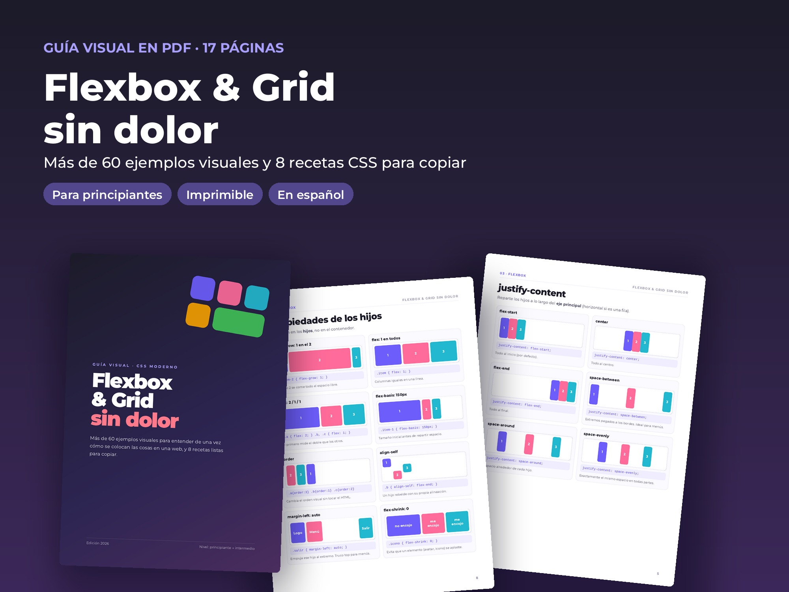
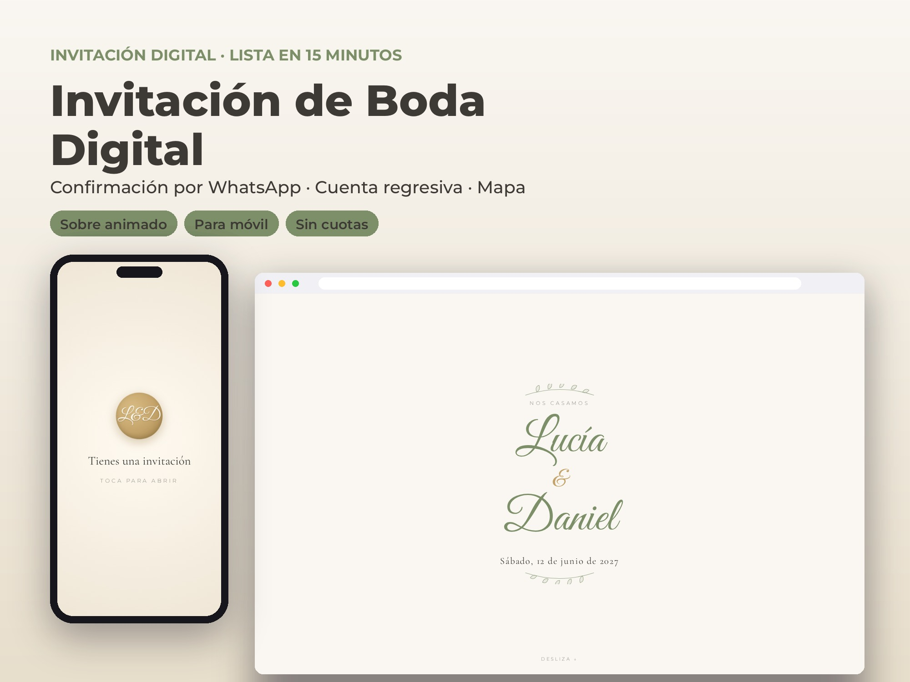
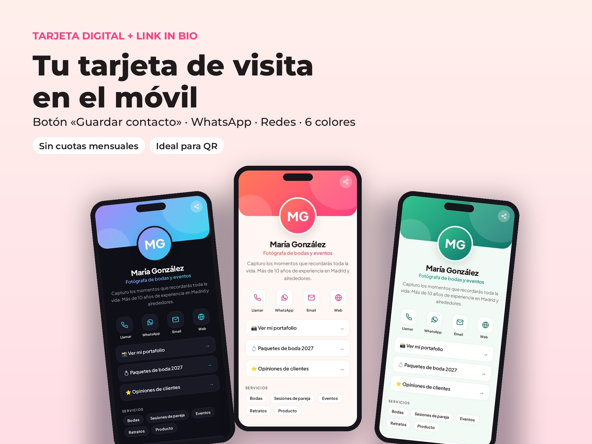
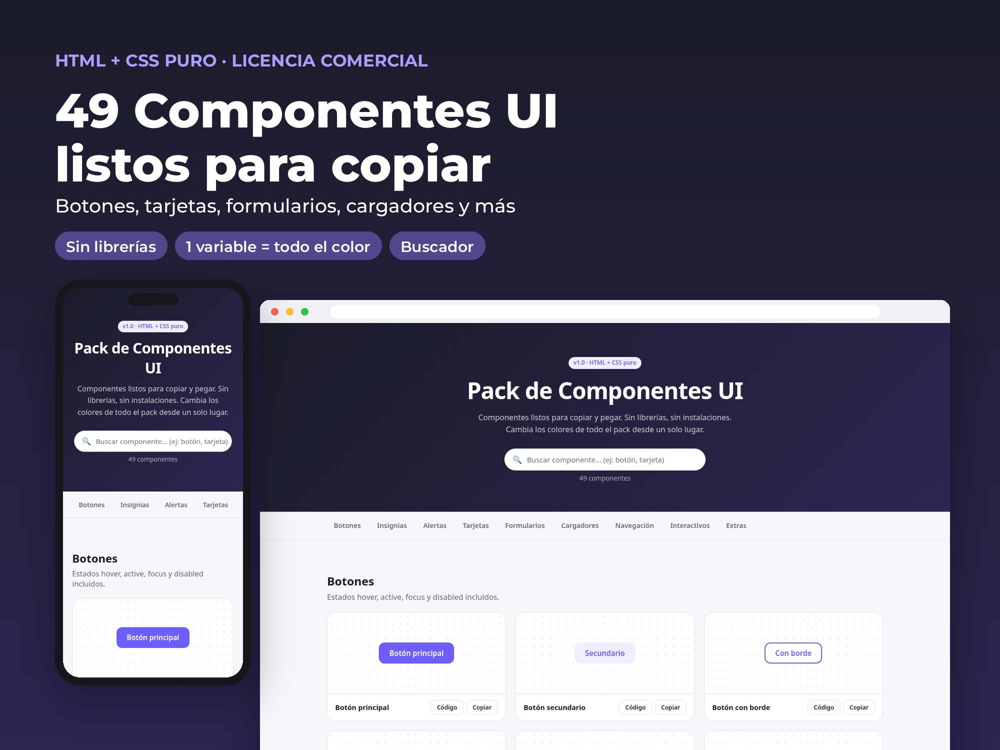
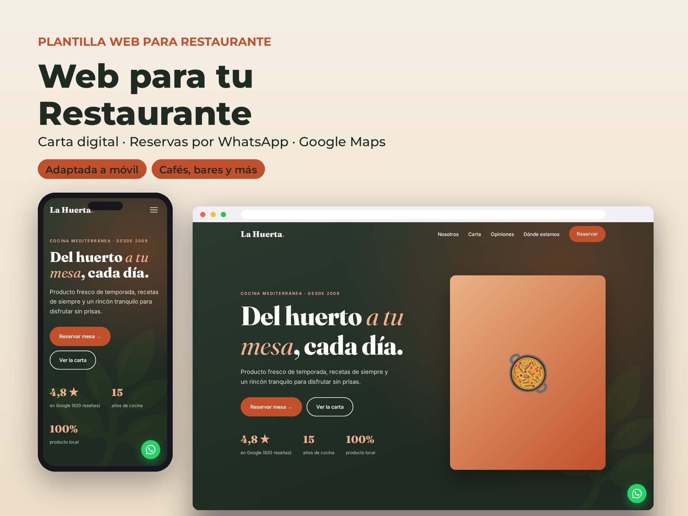

## Demos

- [Web para restaurante](/demos/kit/restaurante/): carta por pestañas, reservas por WhatsApp, mapa y opiniones.
- [Tarjeta digital](/demos/kit/tarjeta-digital/): una página tipo «link in bio» con botones de contacto, enlaces y servicios. Mejor en el móvil.

El resto de productos se enseña solo en imágenes, porque son los archivos que se venden.

## Los cinco productos

**Guía «Flexbox & Grid sin dolor».** PDF de 17 páginas con más de 60 ejemplos visuales y 8 recetas de maquetación para copiar.

**Invitación de boda digital.** Una web que se abre en el móvil con cuenta atrás, mapa y confirmación de asistencia por WhatsApp.

**Tarjeta digital.** Una página de presentación con contacto, enlaces y servicios, que se edita en un solo bloque de datos.

**Pack de 49 componentes UI.** Botones, tarjetas, formularios, cargadores y más, en HTML y CSS sin librerías, con buscador y un botón para copiar el código. Los colores de todo el pack se cambian con una variable.

**Web para restaurante.** Una página completa para un negocio de hostelería, pensada para que el dueño la personalice siguiendo unas instrucciones.

## Decisiones

- **Sin dependencias:** cada producto funciona abriendo un archivo HTML. Quien lo compra no necesita instalar nada.
- **Pensado para personalizarse:** los textos que hay que cambiar están marcados en el código, y cada producto incluye instrucciones paso a paso.
- **Para dos públicos:** plantillas para negocios y particulares, y recursos de aprendizaje y componentes para estudiantes y desarrolladores.

## Mi aportación

Elegí qué productos crear y para quién, definí el diseño de cada uno y preparé el enfoque de venta. El código y los textos se hicieron con asistencia de IA, y yo los dirigí y revisé.
